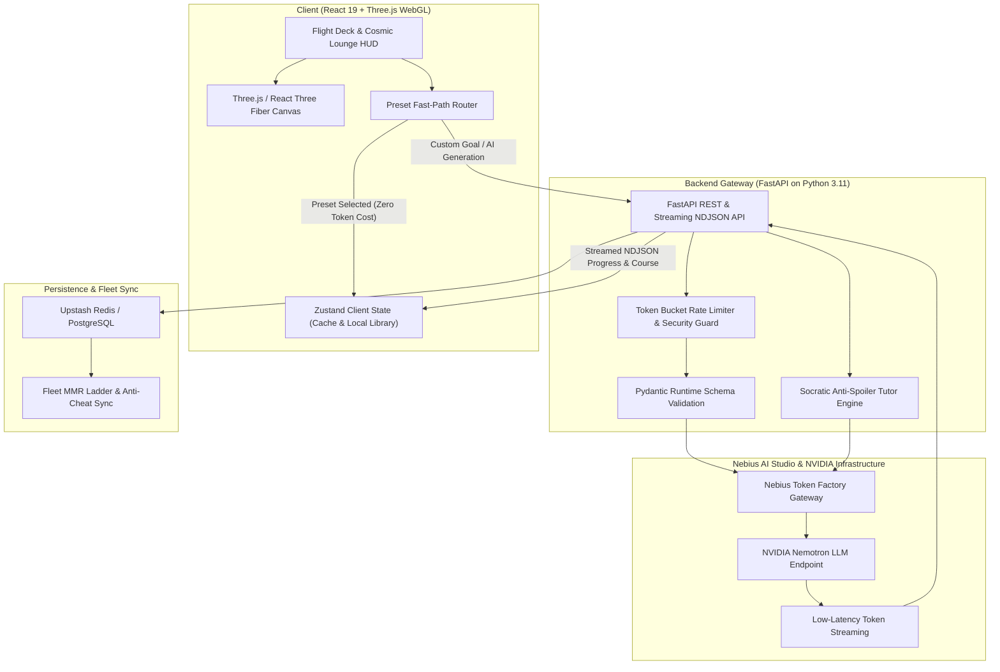

# 🚀 Project NOVA

<div align="center">

[](https://nova-badies.vercel.app/)
[](https://studio.nebius.ai/)
[](https://developer.nvidia.com/)
[](https://react.dev/)
[](https://fastapi.tiangolo.com/)
[](./LICENSE)

**Autonomous, Gamified 3D Learning Platform Built for the Nebius x NVIDIA Global AI Hackathon**

[Live Demo](https://nova-badies.vercel.app/) • [Architecture](#-architecture) • [Nebius & NVIDIA Integration](#-nebius-ai-studio--nvidia-nemotron-integration) • [Quick Start](#-quick-start) • [Evaluation](#-testing--evaluations)

</div>

---

## 🌟 Overview & Hackathon Mission

Online self-directed education suffers from a notorious completion crisis: passive video lectures, rigid one-size-fits-all curricula, and multiple-choice trivia leave learners disengaged and unprepared for practical problem-solving.

**Project NOVA** transforms self-directed learning into an interplanetary expedition. Powered by **NVIDIA Nemotron** on **Nebius AI Studio**, NOVA autonomously deconstructs any ambitious learning goal into a structured multi-planetary curriculum. Every station along the journey features interactive lessons, deep Socratic tutoring with zero-spoiler safety guards, application-driven multi-format quizzes, and a 7-tier spaceship progression ladder (Probe → Titan) driven by real-time MMR (Matchmaking Rating) and spaced-repetition retention curves.

> [!IMPORTANT]
> **Hackathon Track Alignment:**
> * **Autonomous AI Agents & Next-Gen Productivity:** Self-architecting course pipelines, dynamic placement diagnostics, and a shipboard Socratic tutor copilot.
> * **High-Performance Generative AI Inference:** Sub-second streaming responses, multi-stage curriculum structuring, and on-demand practice challenge synthesis powered by Nebius AI Studio's serverless token factory.

---

## ⚡ Nebius AI Studio & NVIDIA Nemotron Integration

NOVA leverages Nebius AI Studio's high-throughput token factory endpoints running NVIDIA Nemotron models:

* **High-Throughput Streaming Course Synthesis:**
  Curriculum generation requires generating hundreds of structured JSON schema fields (modules, topics, definitions, step-by-step analogies, formulas, and 15–20 questions per topic). Nebius AI Studio’s serverless endpoints deliver the low latency and sustained token throughput necessary to stream complete courses in seconds.
* **NVIDIA Nemotron Reasoning:**
  NVIDIA Nemotron (`nvidia/NVIDIA-Nemotron-3-Nano-30B-A3B`) powers NOVA's pedagogical engine. Nemotron excels at following strict JSON schema outputs, ensuring generated courses survive strict Pydantic and TypeScript runtime validation without hallucinated structures.
* **Socratic AI Tutor Copilot with Anti-Spoiler Logic:**
  Learners can summon their shipboard tutor at any time. The copilot uses prompt-guided pedagogical guardrails to explain concepts with custom analogies, diagnose misconceptions, and synthesize fresh practice variations without ever spoiling active quiz answers.
* **Adaptive Diagnostic Placement:**
  Learners uncertain of their expertise level can launch a 5-question diagnostic calibration. Nemotron dynamically evaluates response patterns across difficulty tiers to calibrate the curriculum between `beginner`, `intermediate`, and `advanced`.
* **Preset Fast-Path vs. On-Demand Synthesis:**
  To optimize token efficiency and guarantee instantaneous access to flagship curricula, NOVA includes a local fast-path for benchmark courses (*Neural Networks to Transformers*, *Advanced React Patterns*, *Linear Algebra Basics*, *Cellular Biology*, and *English Essentials*) that loads pre-authored masterclasses immediately without consuming API tokens, while reserving live Nemotron generation for custom user-defined learning goals.

---

## 🏛 Architecture



---

## 🌌 Core Features

| Feature | Description | Powered By |
| :--- | :--- | :--- |
| **Cinematic 3D Flight Deck & Lounge** | Real-time WebGL cockpit and celestial lounge with interactive lighting, reactive particles, and spatial audio. | Three.js, React Three Fiber, GLSL Shaders |
| **Autonomous Curriculum Architect** | Transforms any learning objective into structured modules and bite-sized planetary stations. | NVIDIA Nemotron on Nebius AI Studio |
| **Application-Driven Assessment Forge** | Multi-format quiz engine: MCQs, Multi-Select, True/False, Fill-in-the-Blank, and live executable code challenges. | Nemotron reasoning + Regex validation |
| **Socratic AI Tutor & Anti-Spoiler** | Real-time streaming tutor that answers questions, guides problem-solving, and prevents answer leaks. | Nebius streaming + Socratic guardrails |
| **7-Tier Spacecraft MMR Ladder** | Elo-style skill rating ladder (*Probe → Scout → Corvet → Frigate → Cruiser → Battleship → Titan*) with spaced repetition. | Dynamic MMR calibration + Ebbinghaus curve |
| **Fleet Leaderboard & Crew Rankings** | Real-time global crew standings comparing pilot XP, MMR, cleared planets, and daily streaks. | Upstash Redis REST / Neon PostgreSQL |
| **Avatar Studio & Doodle Pad** | Upload custom flight patches or hand-draw pilot callsigns and avatars directly on an HTML5 canvas. | Canvas API + Local/Remote pilot store |
| **Preset Masterclasses** | Pre-authored textbook-quality courses for instant access without triggering models or token consumption. | In-memory authored content chunks |

---

## 🛠 Tech Stack

* **Frontend:** React 19, TypeScript, Vite, Tailwind CSS v4, Three.js, React Three Fiber, `@react-three/drei`, Framer Motion, Zustand
* **Backend:** Python 3.11, FastAPI, Uvicorn, HTTPX, Pydantic v2, PyPDF, SlowAPI
* **AI & Cloud Infrastructure:** 
  * **Nebius AI Studio:** Serverless Token Factory (`https://api.tokenfactory.nebius.com/v1`)
  * **Models:** `nvidia/NVIDIA-Nemotron-3-Nano-30B-A3B`, Nemotron family
  * **Datastores:** Upstash Redis, Neon PostgreSQL, Vercel Edge Cache
* **Verification & Testing:** Pytest, Playwright, Node.js Contract Validator, GitHub Actions CI

---

## 🚀 Quick Start

### 1. Prerequisites
* **Node.js**: `20.x` or higher (Node 22+ recommended)
* **Python**: `3.11` or higher
* **Nebius API Key**: Obtainable from [Nebius AI Studio](https://studio.nebius.ai/)

### 2. Repository Setup
```bash
git clone https://github.com/Ritanshu-Prasad/project-nova.git
cd project-nova
cp .env.example .env
```

Populate `.env` with your Nebius AI Studio credentials:
```env
NEBIUS_API_KEY=your_nebius_api_key_here
NEBIUS_BASE_URL=https://api.tokenfactory.nebius.com/v1
NOVA_GENERATE_MODEL=nvidia/NVIDIA-Nemotron-3-Nano-30B-A3B
NOVA_TUTOR_MODEL=nvidia/NVIDIA-Nemotron-3-Nano-30B-A3B
```

### 3. Run Frontend
```bash
cd frontend
npm install
npm run dev
```
The client will start at `http://localhost:5173`. The Vite development proxy automatically forwards `/api` requests to the local backend.

### 4. Run Backend
In a separate terminal:
```bash
python -m venv .venv

# On Windows:
.venv\Scripts\activate
# On Linux/macOS:
source .venv/bin/activate

pip install -r backend/requirements.txt
uvicorn backend.main:app --reload --port 8000 --env-file .env
```
The FastAPI backend will start at `http://localhost:8000`. You can inspect the interactive OpenAPI documentation at `http://localhost:8000/docs`.

---

## 🧪 Testing & Evaluations

NOVA includes a multi-tier testing pipeline ensuring high schema fidelity and reliable AI outputs:

```bash
# 1. Backend Unit & Regression Suite (837 tests, zero network dependency)
pip install -r backend/requirements-dev.txt
pytest backend/tests -q

# 2. Frontend Contract Check (validates backend fixtures vs React TypeScript validators)
cd frontend
npm run check:contract

# 3. Production Build Validation
npm run build

# 4. End-to-End Browser Tests (Playwright)
npm run test:e2e

# 5. Live Nemotron Evaluation Suite (evaluates pedagogical quality & token efficiency)
cd ../backend
python -m evals.run_eval --cases smoke
```

---

## 📊 Observability & Cost Tracking

NOVA includes a built-in admin dashboard for real-time observability:
* **Cost & Token Telemetry:** Tracks input/output token counts, pricing, and latency across Nebius model calls.
* **Course Quality Metrics:** Audits question validity, variety, and student error rates.
* Access the dashboard at `http://localhost:8000/admin` by supplying the `NOVA_ADMIN_TOKEN` configured in your `.env`.

---

## 🛡 Security & Git Workflow

* **Pre-Push Security Hooks:** Automated git hooks scan for uncommitted secrets, API keys, and run build checks prior to pushing.
* **Safe Branching:** Review [`TEAM_GIT_WORKFLOW.md`](./TEAM_GIT_WORKFLOW.md) for team branch policies and pull request requirements.

---

## 🏆 Hackathon Acknowledgements

Built with passion for the **Nebius x NVIDIA Global AI Hackathon**. Special thanks to the **Nebius AI Studio** and **NVIDIA** engineering teams for providing state-of-the-art serverless AI infrastructure and high-performance Nemotron reasoning models.