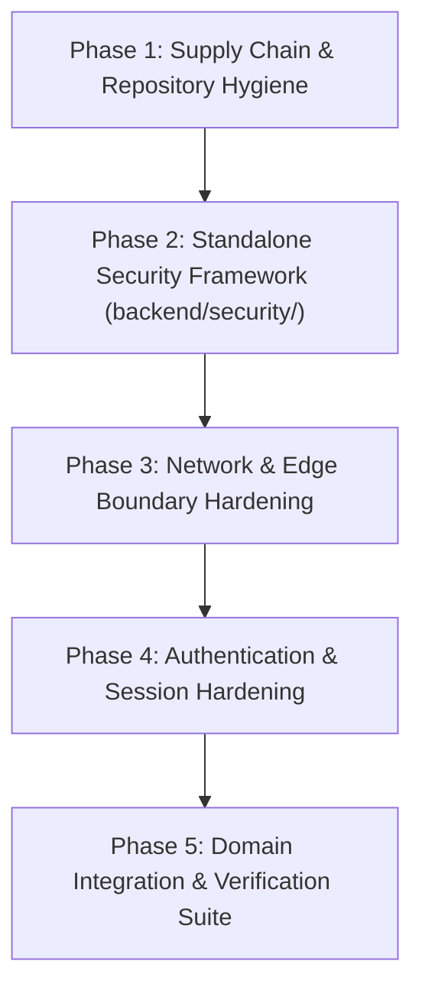

# Project Nova — Modular Security Implementation Plan
> **Target Branch:** `main`  
> **Source Reference:** `project-nova-security-Shrinkhal01` (Commit `d2afe24`)  
> **Author:** Antigravity Engineering (Pair-Programming with Shrinkhal)  
> **Status:** Architecture & Planning Phase — **NO CODE IMPLEMENTATION YET**  
> **Design Objective:** Standalone, Modular, and Portable Security Architecture (Zero Domain Pollution)

---

## Table of Contents
1. [Executive Summary & Current State](#1-executive-summary--current-state)
2. [Branch Discrepancy & Gap Analysis](#2-branch-discrepancy--gap-analysis)
3. [The 9 Core Remediations (FIX-001 to FIX-009)](#3-the-9-core-remediations-fix-001-to-fix-009)
4. [Modular & Portable Security Architecture Design](#4-modular--portable-security-architecture-design)
5. [Phased Implementation Roadmap](#5-phased-implementation-roadmap)
6. [Verification, Testing & CI Hardening Matrix](#6-verification-testing--ci-hardening-matrix)
7. [Portability Blueprint: Applying to Any Other Repository](#7-portability-blueprint-applying-to-any-other-repository)

---

## 1. Executive Summary & Current State

### 1.1 Local Workspace Verification
The active workspace has been fully synced, inspected, and verified against remote `origin/main` at commit `ae6eee4` (*"feat(space): procedural planetary environments and cockpit-to-lounge transit"*). 

```bash
$ git status
On branch main
Your branch is up to date with 'origin/main'.
```

The current `main` branch includes all recent architectural advancements:
- Procedural Three.js 3D planetary environments & cockpit transit animations.
- Interactive course generation and outline revision workflows (`PlanReview.tsx`).
- Structured telemetry and trace logging.
- Sine-wave course trajectories and adaptive MMR calibration.
- Neon Postgres database persistence alongside Upstash Redis.

### 1.2 Core Objective
On the reference branch `project-nova-security-Shrinkhal01`, a comprehensive security audit identified and remediated **9 critical vulnerabilities** (FIX-001 through FIX-009), backed by extensive documentation and verification artifacts.

However, in `project-nova-security-Shrinkhal01`, security controls were embedded directly into domain files (`backend/main.py`, `backend/accounts.py`, `backend/fleet.py`). 

**The architectural directive for `main` is different:**
> **Build an independent, modular, and portable security layer.**  
> Keep `main` free from clutter and domain-coupling so that the security system can be maintained independently, audited cleanly, and **lifted into any other FastAPI/ASGI repository with zero code modifications**.

---

## 2. Branch Discrepancy & Gap Analysis

A granular comparison between `origin/main` (`ae6eee4`) and `origin/project-nova-security-Shrinkhal01` (`d2afe24`) reveals the following structural differences:

| Domain / Subsystem | `project-nova-security-Shrinkhal01` (`d2afe24`) | Current `main` (`ae6eee4`) | Gap / Remediation Strategy on `main` |
| :--- | :--- | :--- | :--- |
| **CORS & Headers** | Strict origin whitelist, restricted HTTP methods, restricted headers | `DEFAULT_ORIGINS` parsed, but wildcard `allow_methods=["*"]` and `allow_headers=["*"]` remain | Restrict methods and headers to explicit allowlists via modular middleware. |
| **AI Tutor Protection** | In-route sliding window rate limiter (15 req/60s), prompt boundary tags (`<lesson_reference>`), prompt sanitization, CSRF verification | Standalone router `backend/tutor.py`, `TUTOR_LIMIT` via `limits.py`, but prompt boundary isolation and CSRF validation are missing | Wrap lesson context in explicit security boundaries; enforce CSRF and input sanitization without tangling prompt engineering. |
| **Upload Endpoints** | Completely removed dead avatar/doodle upload endpoints and `/uploads` static mount | Endpoints already removed on `main` | Retain lean surface; add automated regression tests verifying upload routes return 404. |
| **Dev Auth Backdoor** | Multi-factor production check (`IS_PRODUCTION = (ENVIRONMENT == "production") or ON_VERCEL`), email regex, pilot name sanitization | `auth_dev` only checks `ON_VERCEL` and `NOVA_DEV_LOGIN != "1"`; missing email regex and name sanitization | Implement portable environment-gating guard and strict dev-login schema validator. |
| **Leaderboard Concurrency** | `_board_lock = asyncio.Lock()`, 5.0s submission throttling, `MAX_XP_DELTA = 5000`, `MAX_INITIAL_XP = 50000`, HTML entity sanitization | Has `asyncio.Lock()` and throttling, but `MAX_XP_DELTA = 50000` (10x higher), initial XP unbounded, `_clean_name` only strips `<>` | Port strict delta bounds and comprehensive character sanitization (`<>&"'`). |
| **Progress Sync Ingestion** | Full Pydantic v2 validation schema (`PilotSaveModel`, prototype pollution block, size & bounds checking) | Uses bare `save: dict` without schema validation; any arbitrary JSON structure can be persisted | Introduce standalone Pydantic validation schema layer to eliminate stored denial-of-service and corrupted states. |
| **Session Secret Lifecycle** | Persistent local secret file (`backend/.data/dev_session_secret.txt`), fail-fast production startup validation | Persistent local secret file exists (`DEV_SECRET_FILE`), but startup production validation assertion is missing | Add fail-fast production startup hook checking entropy, length (>=32), and trivial defaults. |
| **Supply Chain** | Pinned dependencies in `requirements.txt` and `requirements.lock` | `backend/requirements.txt` has unpinned core packages (`fastapi`, `uvicorn`, `httpx`, `python-dotenv`) | Pin all production dependencies in `requirements.txt` matching `requirements.lock`. |
| **Repository Hygiene** | UTF-8 `.gitignore` with comprehensive secret exclusion matrix, `.env.example` template | `.gitignore` has basic rules; `.env.example` exists | Synchronize `.gitignore` rules with full secret and cache exclusion matrix. |

---

## 3. The 9 Core Remediations (FIX-001 to FIX-009)

### FIX-001: Strict CORS Origin Whitelisting & Header Restriction
- **Threat Vector:** Critical (CVSS 8.1). Reflected origin CORS with `allow_credentials=True` allows malicious external sites to execute cross-origin authenticated requests and read sensitive pilot data.
- **Remediation Specification:**
  - Whitelist origins strictly via environment variable `ALLOWED_ORIGINS` (comma-separated), falling back to localhost dev hosts.
  - Reject wildcard origins (`*`).
  - Restrict `allow_methods` strictly to `["GET", "POST", "PUT", "DELETE", "OPTIONS"]`.
  - Restrict `allow_headers` strictly to `["Content-Type", "X-Nova", "Authorization"]`.
  - Reject untrusted origins during preflight `OPTIONS` requests.

### FIX-002: AI Tutor Authentication, Rate Limiting & Prompt Injection Guardrails
- **Threat Vector:** High (CVSS 8.2). Unauthenticated/unmetered AI tutor endpoint acts as an open proxy for Nebius/NVIDIA LLM credits. Unsanitized user inputs allow prompt injection and persona hijacking.
- **Remediation Specification:**
  - Enforce CSRF header `X-Nova: 1` on tutor chat endpoints.
  - Configure frontend client (`frontend/src/core/tutor.ts`) to transmit `credentials: 'same-origin'` and `X-Nova: 1`.
  - Isolate untrusted lesson and curriculum text inside `<lesson_reference>` boundary tags with strict system directives instructing the LLM to treat reference blocks as passive untrusted data.
  - Sanitize client messages to strip control characters (`\x00-\x1f\x7f`) and boundary escape sequences (`</lesson_reference>`).
  - Enforce sliding-window rate limit (15 requests per 60 seconds per pilot/IP).

### FIX-003: Removal of Dangling File Upload Endpoints & Static Mount
- **Threat Vector:** High (CVSS 7.1). Orphaned public file upload endpoints allow arbitrary file uploads, disk exhaustion (DoS), and malware hosting.
- **Remediation Specification:**
  - Verify complete elimination of `POST /api/users/avatar/upload`, `POST /api/users/avatar/doodle`, and `/uploads` static mount.
  - Validate that avatar profile pictures are handled exclusively via client-side downsampled Data URLs (WebP/JPEG, capped at 600 KB).

### FIX-004: Multi-Layered Environment Gating & Input Validation for Dev Login
- **Threat Vector:** Medium (CVSS 6.5). Developer authentication backdoor accessible in non-Vercel production environments (Docker, AWS, Railway) if `NOVA_DEV_LOGIN=1` is set. Unvalidated email input permits Redis key injection.
- **Remediation Specification:**
  - Implement multi-factor environment gating:
    ```python
    IS_PRODUCTION = (os.getenv("ENVIRONMENT") == "production") or bool(os.getenv("VERCEL"))
    ```
  - Strictly return `404 Not Found` if `IS_PRODUCTION` is True, even if `NOVA_DEV_LOGIN=1` is passed.
  - Validate email format with strict regex (`^[a-zA-Z0-9_.+-]+@[a-zA-Z0-9-]+\.[a-zA-Z0-9-.]+$`, max 100 characters).
  - Sanitize display name (strip `<>`, control characters, max 50 characters).
  - Enforce `secure=True` on session cookies in production.

### FIX-005: Leaderboard Concurrency Locking, Submission Throttling & Delta Validation
- **Threat Vector:** Medium (CVSS 6.5). Race conditions during read-modify-write on leaderboard JSON blob. Self-reported scores permit arbitrary score inflation and top-500 eviction.
- **Remediation Specification:**
  - Wrap read-modify-write operations in an `asyncio.Lock()`.
  - Throttle submissions to at most one update per 5.0 seconds per `pilotId` (HTTP 429).
  - Anti-Cheat Clamping:
    - Maximum single XP jump (`MAX_XP_DELTA = 5000`).
    - Maximum initial XP claim on registration (`MAX_INITIAL_XP = 50000`).
    - Prevent score degradation (XP cannot decrease).
  - Sanitize callsigns and course titles against HTML/script injection (`<>&"'`).

### FIX-006: Pydantic Schema Validation & Bound Enforcement for Progress Sync
- **Threat Vector:** Medium (CVSS 6.8). Ingestion of unvalidated arbitrary JSON blobs (`save: dict`) allows stored denial-of-service, client-side crashes on `applySave()`, and prototype pollution.
- **Remediation Specification:**
  - Implement strongly typed Pydantic models for all components of `PilotSave`:
    - `StatsSyncModel`: Bounds checking for XP (0–10M), streaks, correct/answered counts.
    - `TopicProgressModel` & `ModuleProgressModel`: Learning progress bounds and sanitized notes.
    - `CourseSkillModel`: MMR bounds (0–10,000) and history array caps.
    - `LibraryEntryModel`: Prototype pollution protection (block `__proto__`, `constructor`, `prototype`).
    - `HubSyncModel`: Bounds on quiz storage (max 100) and schedule maps.
    - `ProfileSyncModel`: Sanitize callsigns, enforce avatar URI format and size (<=600KB), validate theme colors.
  - Reject payloads that violate schema with HTTP 422 Unprocessable Entity.

### FIX-007: Persistent Local Secret & Fail-Fast Production Startup Validation
- **Threat Vector:** Low / Operational (CVSS 3.7). In-memory dev secrets cause session invalidation across multi-worker Uvicorn processes and live reloads. Missing production secrets fail late at request time.
- **Remediation Specification:**
  - In development, generate and persist secret in `.data/dev_session_secret.txt` (chmod 0600) so all worker processes share the same key.
  - Add fail-fast validation executed immediately on application startup:
    - If `IS_PRODUCTION` is True, verify `SESSION_SECRET` is defined.
    - Enforce minimum length of 32 characters.
    - Block insecure trivial defaults (`"secret"`, `"changeme"`, `"default"`, `"12345678901234567890123456789012"`).
    - Abort startup with explicit `RuntimeError` before accepting any traffic.

### FIX-008: Strict Dependency Pinning, Dead Package Pruning & Lockfile Generation
- **Threat Vector:** Low / Supply Chain (CVSS 3.7). Unpinned packages in `requirements.txt` introduce build non-determinism, unexpected upstream breaks, and supply-chain tampering risks.
- **Remediation Specification:**
  - Pin exact package versions in `backend/requirements.txt`.
  - Maintain a verified `backend/requirements.lock` reflecting the pinned tree.
  - Remove dead or unused dependencies.

### FIX-009: UTF-8 Gitignore Normalization & Comprehensive Secret Exclusion
- **Threat Vector:** Medium (CVSS 6.5). Non-standard encoding or incomplete gitignore rules risk accidental exposure of `.env` files, API keys, database credentials, and local state.
- **Remediation Specification:**
  - Ensure `.gitignore` is encoded in clean UTF-8 (LF line endings, no BOM).
  - Comprehensive exclusion matrix covering `.env*` (with `!.env.example` negation), `.data/`, SQLite databases, Python bytecodes, and OS metadata.

---

## 4. Modular & Portable Security Architecture Design

To satisfy the user directive—*keeping `main` clean, independent, and portable to any other repository*—all security controls will be decoupled into a dedicated, self-contained Python package: `backend/security/`.

### 4.1 Architecture Diagram

```
backend/
├── security/                           # ← 100% PORTABLE SECURITY SUBSYSTEM
│   ├── __init__.py                     # Clean package exports
│   ├── env.py                          # Multi-factor environment & production detection
│   ├── secrets.py                      # Persistent dev secrets & production fail-fast startup validator
│   ├── cors.py                         # Strict CORS policy builder & origin parser
│   ├── csrf.py                         # CSRF token & custom-header verification dependency
│   ├── rate_limiter.py                 # Sliding-window & token-bucket rate limiters
│   ├── guardrails.py                   # LLM prompt injection boundary wrappers & text sanitizers
│   ├── anti_cheat.py                   # Async concurrency locks, score delta & throttle validators
│   └── schemas/                        # Portable Pydantic validation models
│       ├── __init__.py
│       ├── base.py                     # SafeBaseModel (prototype pollution prevention)
│       └── progress.py                 # PilotSaveModel & sync state schemas
│
├── accounts.py                         # Clean domain logic (imports security dependencies)
├── fleet.py                            # Clean domain logic (imports security dependencies)
├── tutor.py                            # Clean domain logic (imports security dependencies)
└── main.py                             # Clean FastAPI root (wires security middlewares)
```

### 4.2 Module Specifications

#### 1. `backend/security/env.py` (Portable Environment Resolver)
- Zero external dependencies (uses standard library `os`).
- Detects production across Vercel, AWS, GCP, Azure, Kubernetes, Railway, Render, Docker.
- Exports `is_production() -> bool` and `get_environment() -> str`.

#### 2. `backend/security/secrets.py` (Secret Management & Startup Validation)
- Provides `get_session_secret() -> bytes`.
- Deterministically reads/creates `.data/dev_session_secret.txt` with file permissions `0600` for multi-worker dev parity.
- Exports `validate_secrets_on_startup() -> None` with checks for minimum 32-character entropy and trivial default rejection.

#### 3. `backend/security/cors.py` (CORS Policy Factory)
- Provides `configure_cors(app: FastAPI) -> None`.
- Reads `ALLOWED_ORIGINS` from environment, sanitizes URLs, and disallows `*` when credentials are enabled.
- Restricts methods to `GET, POST, PUT, DELETE, OPTIONS`.
- Restricts headers to `Content-Type, X-Nova, Authorization`.

#### 4. `backend/security/csrf.py` (CSRF Protection Dependency)
- Provides FastAPI dependency `require_csrf_header(header_name: str = "X-Nova", expected_value: str = "1")`.
- Reusable on any route via `dependencies=[Depends(require_csrf_header)]`.

#### 5. `backend/security/rate_limiter.py` (In-Memory Sliding Window Limiter)
- Standalone class `SlidingWindowRateLimiter(max_requests: int, window_seconds: float)`.
- Thread-safe / asyncio-safe.
- Client identifier extractor supports user ID from cookie/session, falling back to client IP.
- Raises standard `HTTPException(429, detail=..., headers={"Retry-After": ...})`.

#### 6. `backend/security/guardrails.py` (LLM Guardrails & Boundary Isolation)
- `sanitize_prompt_input(text: str, max_chars: int) -> str`: Strips control characters and escape tags.
- `wrap_untrusted_context(tag: str, content: str) -> str`: Generates strictly delimited XML reference boundaries with system guidance directives.

#### 7. `backend/security/anti_cheat.py` (Concurrency & Delta Guards)
- `ScoreConcurrencyGuard`: Provides per-entity async locks and submission throttling.
- `validate_score_delta(previous_xp: int, new_xp: int, max_delta: int, max_initial: int) -> int`.
- `sanitize_text(text: str, max_length: int) -> str`: Strips dangerous HTML entities (`<>&"'`).

#### 8. `backend/security/schemas/` (Pydantic Ingestion Defense)
- `SafeBaseModel`: Pydantic V2 base model that validates dictionary keys against `__proto__`, `constructor`, `prototype`.
- Strongly typed sub-models with numeric ranges (`ge`, `le`) and regex validators.

---

## 5. Phased Implementation Roadmap

When authorized to implement, execution will proceed strictly according to these 5 distinct phases:



### Phase 1: Supply Chain & Repository Hygiene
* **FIX-008:** Pin versions in `backend/requirements.txt` to match `backend/requirements.lock`.
* **FIX-009:** Ensure `.gitignore` is clean UTF-8 with standard LF line endings and includes comprehensive secret exclusions (`.env*`, `.data/`, caches).

### Phase 2: Standalone Security Framework (`backend/security/`)
* Create the `backend/security/` module directory.
* Implement `env.py`, `secrets.py`, `cors.py`, `csrf.py`, `rate_limiter.py`, `guardrails.py`, and `schemas/`.
* Write unit tests in `backend/tests/test_security_module.py` ensuring the security layer is 100% self-verifying before wiring it into routes.

### Phase 3: Network & Edge Boundary Hardening
* **FIX-001:** Update `backend/main.py` to use `backend/security/cors.py` (restrict methods & headers).
* **FIX-003:** Confirm upload endpoints are absent and add automated tests ensuring `/api/users/avatar/*` returns 404.

### Phase 4: Authentication & Session Hardening
* **FIX-007:** Wire `validate_secrets_on_startup()` into `backend/main.py` startup event / lifespan.
* **FIX-004:** Update `backend/accounts.py` dev login route to use `backend/security/env.py` and strict email validation schema.

### Phase 5: Domain Integration & Verification Suite
* **FIX-002:** In `backend/tutor.py`, integrate `guardrails.py` boundary tags and CSRF protection. In `frontend/src/core/tutor.ts`, ensure `X-Nova: 1` and `credentials: 'same-origin'` are transmitted.
* **FIX-005:** In `backend/fleet.py`, integrate `anti_cheat.py` locks, throttling, and clamped deltas.
* **FIX-006:** In `backend/accounts.py`, replace `save: dict` with `PilotSaveModel`.
* Run backend test suite (`pytest`) and contract checks (`npm run check:contract`).

---

## 6. Verification, Testing & CI Hardening Matrix

| Target Fix | Automated Test Case | Verification Command | Expected Assertion |
| :--- | :--- | :--- | :--- |
| **FIX-001** | CORS unauthorized origin rejection | `curl -i -X OPTIONS "http://localhost:8000/api/auth/me" -H "Origin: https://evil.com"` | Header `access-control-allow-origin` is omitted |
| **FIX-001** | CORS authorized origin acceptance | `curl -i -X OPTIONS "http://localhost:8000/api/auth/me" -H "Origin: http://localhost:5173"` | `access-control-allow-origin: http://localhost:5173` returned |
| **FIX-002** | AI Tutor missing CSRF header | `curl -i -X POST "http://localhost:8000/api/tutor/chat" -d '{"messages":[]}'` | `403 Forbidden` (`Missing X-Nova header`) |
| **FIX-002** | AI Tutor rate limit trigger | 16 rapid requests to `/api/tutor/chat` | 16th request returns `429 Too Many Requests` |
| **FIX-003** | Dangling upload endpoint check | `curl -i -X POST "http://localhost:8000/api/users/avatar/upload"` | `404 Not Found` |
| **FIX-004** | Dev backdoor in production | `ENVIRONMENT=production curl -i -X POST "http://localhost:8000/api/auth/dev"` | `404 Not Found` |
| **FIX-004** | Dev backdoor email injection | `curl -i -X POST "http://localhost:8000/api/auth/dev" -d '{"email":"invalid"}'` | `400 Bad Request` (`Invalid email format`) |
| **FIX-005** | Leaderboard rapid submission | Two consecutive score posts within 3 seconds | Second post returns `429 Too Many Requests` |
| **FIX-005** | Leaderboard XP spike clamp | Post score jumping +100,000 XP | Request rejected or clamped to `MAX_XP_DELTA` |
| **FIX-006** | Progress sync prototype pollution | PUT progress with `{"course":{"__proto__":{...}}}` | `422 Unprocessable Entity` |
| **FIX-006** | Progress sync malicious callsign | PUT progress with `{"profile":{"callsign":"<script>..."}}` | `<script>` stripped; callsign sanitized |
| **FIX-007** | Startup fail-fast on missing secret | `ENVIRONMENT=production python -c "from security.secrets import validate_secrets_on_startup; validate_secrets_on_startup()"` | Raises `RuntimeError: SESSION_SECRET is not configured` |
| **FIX-008** | Dependency integrity check | `pip check` | Exits 0 with no broken or missing dependencies |
| **FIX-009** | Secret ignore check | `git check-ignore -v .env .env.local backend/.data/dev_session_secret.txt` | All files match `.gitignore` rules |

---

## 7. Portability Blueprint: Applying to Any Other Repository

Because `backend/security/` is designed with **zero domain coupling**, here is how this security layer can be imported into any other FastAPI or ASGI repository:

### Step 1: Copy Folder
Copy `backend/security/` into the target repository's Python source tree:
```bash
cp -r backend/security /path/to/target-repo/src/security
```

### Step 2: Configure Application Root (`main.py`)
In the target app's entrypoint, add two lines:
```python
from fastapi import FastAPI
from security.cors import configure_cors
from security.secrets import validate_secrets_on_startup

app = FastAPI()

# 1. Validate secrets before accepting traffic
validate_secrets_on_startup()

# 2. Attach strict, standardized CORS policy
configure_cors(app)
```

### Step 3: Protect Sensitive Endpoints
Use the modular dependencies on any route requiring defense:
```python
from fastapi import APIRouter, Depends, Request
from security.csrf import require_csrf
from security.rate_limiter import SlidingWindowRateLimiter

router = APIRouter()
limiter = SlidingWindowRateLimiter(max_requests=20, window_seconds=60)

@router.post("/api/sensitive-action", dependencies=[Depends(require_csrf), Depends(limiter)])
async def sensitive_action():
    return {"status": "protected"}
```

---

> [!NOTE]
> **Plan Only Directive:** No backend or frontend application code on `main` was altered during the creation of this document. Implementation will begin only upon explicit user confirmation and instruction.
